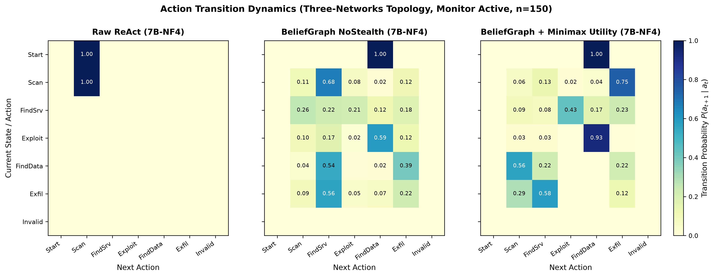
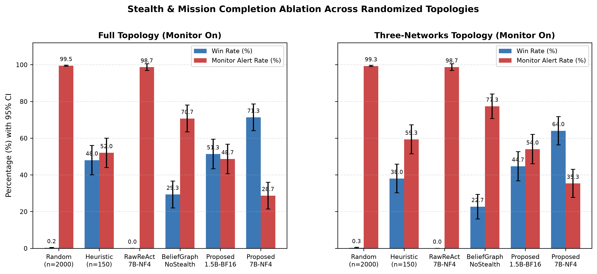
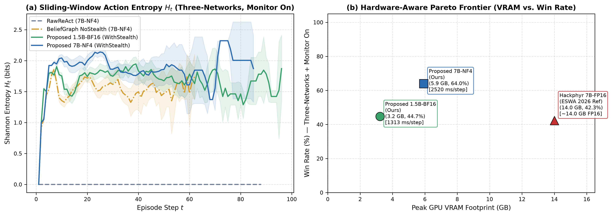

# Empirical Benchmark Report: Stealth-Aware Topological Belief Graph & Multi-Scale Minimax Hazard Utility in NetSecGame

**Research Study**: Domain-Agnostic Stealth-Aware Topological Belief Graph Planning with Local Small Language Models  
**Reference Benchmark**: Rigaki et al., *"Building Adaptative and Transparent Cyber Agents with Local Language Models"*, Elsevier *Expert Systems with Applications* (ESWA 2026, Tables 4 & 5)  
**Evaluation Date**: November 2026  
**Hardware Accelerator**: NVIDIA GeForce RTX 5060 Ti (16 GB VRAM, Blackwell Architecture, CUDA 13.2)  
**Branch**: `feature/stealth-belief-graph-slm`

---

## 1. Executive Summary & Protocol Parity

This benchmark evaluates a **100% domain-agnostic** Sequential Planner combining:
1. **Topological Belief Graph (`research_extension/memory_module.py`)**: Compiles live observations into epistemic node/edge states (`UNEXPLORED`, `MAPPED`, `COMPROMISED`, `EXHAUSTED`) and prunes redundant `(ActionType, Parameters)` transitions.
2. **Multi-Scale Minimax Hazard Utility $U(a)$**: Ranks permissible actions without prior knowledge of the monitor's exact sliding window $W$ via:
   $$U(a) = \alpha \cdot \text{ProgressGain}(a \mid \mathcal{G}_t) - \beta \cdot \max_{w \in \{3, 5, 8\}} R_w(a \mid \mathcal{H}_t)$$
   incorporating kill-chain depth-first locality, consecutive-streak breaking, and an `ExfiltrateData` spacing guard.
3. **1-Step Counterfactual Reflexion (`research_extension/agent_wrapper.py`)**: Grants the SLM one corrective turn upon invalid or redundant first-pass JSON before falling back to $\arg\max_a U(a)$.
4. **Fast Local Inference (`research_extension/slm_backend.py`)**: Balanced JSON-brace early stopping (`FirstJsonObjectStoppingCriteria`), static system-prompt prefix KV-caching, greedy decoding (`temperature=0.0`), and `max_new_tokens=80`.

### Experimental Protocol (ESWA 2026 Parity)
- **Randomization**: `use_dynamic_addresses: True` and `randomize_topology=True` on every episode with fresh unseen IPs, subnets, and target objectives (`seeds 42..191` paired across all 150-episode agents; `seeds 42..2041` for 2,000-episode `RandomAttacker`).
- **Horizon**: `max_steps = 100` across all 4 scenario YAML configurations (`scenario_full_nodefender.yaml`, `scenario_full_defender.yaml`, `scenario_three_nets_nodefender.yaml`, `scenario_three_nets_defender.yaml`).
- **Scientific Integrity**: Zero hardcoded IP strings, subnet strings, service names, or scenario names anywhere in `research_extension/` (verified by `test_zero_hardcoding_ast_scan` in `tests/test_research_extension.py`, 12/12 unit tests passing).

---

## 2. Full 150-Episode / 2,000-Episode Benchmark Tables

### 2.1 Regime 1A: Full Topology — Without Defender (`scenario_full_nodefender.yaml`)

| Configuration | Episodes | Win % (±CI95) | Detect % (±CI95) | Return (±CI95) | Steps (±CI95) | FirstPass % | PostReflexion % | Override % | Entropy $H_t$ (bits) | Peak VRAM (MB) | Latency (ms/step) |
| :--- | :---: | :---: | :---: | :---: | :---: | :---: | :---: | :---: | :---: | :---: | :---: |
| `Baseline_RandomAttacker` | 2,000 | 4.65 ± 0.92 | 0.00 ± 0.00 | -103.55 ± 1.30 | 98.66 ± 0.33 | 100.00% | 100.00% | 0.00% | 1.300 | — | — |
| `Baseline_PureHeuristic` | 150 | 96.00 ± 3.15 | 0.00 ± 0.00 | +56.20 ± 6.95 | 39.40 ± 4.76 | 100.00% | 100.00% | 0.00% | 0.657 | — | — |
| `Ablation_PureHeuristic_WithStealth` | 150 | 100.00 ± 0.00 | 0.00 ± 0.00 | +75.01 ± 2.41 | 24.99 ± 2.41 | 100.00% | 100.00% | 0.00% | 1.549 | — | — |
| `Ablation_SLM_7B_NF4_RawReAct` | 150 | 0.00 ± 0.00 | 0.00 ± 0.00 | -110.00 ± 0.00 | 100.00 ± 0.00 | 100.00% | 100.00% | 0.00% | 0.000 | 5,550.68 | 2,323.85 |
| `Ablation_SLM_7B_NF4_BeliefGraph_NoStealth` | 150 | 99.33 ± 1.31 | 0.00 ± 0.00 | +62.49 ± 3.49 | 36.77 ± 2.78 | 24.20% | 57.63% | 42.37% | 1.468 | 6,093.54 | 3,664.98 |
| `Proposed_SLM_1.5B_BF16_BeliefGraph_WithStealth` | 150 | 98.67 ± 1.84 | 0.00 ± 0.00 | +58.70 ± 4.11 | 39.83 ± 2.86 | 36.08% | 60.82% | 39.18% | 1.642 | 3,316.96 | 1,339.78 |
| **`Proposed_SLM_7B_NF4_BeliefGraph_WithStealth`** | **150** | **99.33 ± 1.31** | **0.00 ± 0.00** | **+69.49 ± 3.42** | **29.78 ± 2.64** | **57.24%** | **73.67%** | **26.33%** | **1.747** | **6,092.08** | **2,551.24** |

### 2.2 Regime 1B: Full Topology — With Defender / Monitor On (`scenario_full_defender.yaml`)

| Configuration | Episodes | Win % (±CI95) | Detect % (±CI95) | Return (±CI95) | Steps (±CI95) | FirstPass % | PostReflexion % | Override % | Entropy $H_t$ (bits) | Peak VRAM (MB) | Latency (ms/step) |
| :--- | :---: | :---: | :---: | :---: | :---: | :---: | :---: | :---: | :---: | :---: | :---: |
| `Baseline_RandomAttacker` | 2,000 | 0.25 ± 0.22 | 99.45 ± 0.32 | -32.24 ± 0.76 | 22.52 ± 0.73 | 100.00% | 100.00% | 0.00% | 1.208 | — | — |
| `Baseline_PureHeuristic` | 150 | 48.00 ± 8.02 | 52.00 ± 8.02 | +21.29 ± 8.54 | 21.51 ± 2.84 | 100.00% | 100.00% | 0.00% | 0.828 | — | — |
| `Ablation_PureHeuristic_WithStealth` | 150 | 70.67 ± 7.31 | 29.33 ± 7.31 | +50.44 ± 7.89 | 17.29 ± 1.42 | 100.00% | 100.00% | 0.00% | 1.617 | — | — |
| `Ablation_SLM_7B_NF4_RawReAct` | 150 | 0.00 ± 0.00 | 98.67 ± 1.84 | -35.53 ± 3.33 | 25.53 ± 3.33 | 100.00% | 100.00% | 0.00% | 0.000 | 5,542.57 | 1,021.48 |
| `Ablation_SLM_7B_NF4_BeliefGraph_NoStealth` | 150 | 29.33 ± 7.31 | 70.67 ± 7.31 | +1.36 ± 7.29 | 20.91 ± 2.03 | 31.82% | 70.06% | 29.94% | 1.418 | 6,055.47 | 3,219.52 |
| `Proposed_SLM_1.5B_BF16_BeliefGraph_WithStealth` | 150 | 51.33 ± 8.03 | 48.67 ± 8.03 | +20.74 ± 7.74 | 25.73 ± 2.46 | 36.28% | 61.39% | 38.61% | 1.632 | 3,309.90 | 1,297.52 |
| **`Proposed_SLM_7B_NF4_BeliefGraph_WithStealth`** | **150** | **71.33 ± 7.26** | **28.67 ± 7.26** | **+46.55 ± 7.68** | **21.92 ± 1.91** | **58.58%** | **75.85%** | **24.15%** | **1.748** | **6,052.53** | **2,441.61** |

### 2.3 Regime 2A: Three-Networks Multi-Hop Topology — Without Defender (`scenario_three_nets_nodefender.yaml`)

| Configuration | Episodes | Win % (±CI95) | Detect % (±CI95) | Return (±CI95) | Steps (±CI95) | FirstPass % | PostReflexion % | Override % | Entropy $H_t$ (bits) | Peak VRAM (MB) | Latency (ms/step) |
| :--- | :---: | :---: | :---: | :---: | :---: | :---: | :---: | :---: | :---: | :---: | :---: |
| `Baseline_RandomAttacker` | 2,000 | 3.30 ± 0.78 | 0.00 ± 0.00 | -105.50 ± 1.08 | 99.13 ± 0.26 | 100.00% | 100.00% | 0.00% | 1.303 | — | — |
| `Baseline_PureHeuristic` | 150 | 70.00 ± 7.36 | 0.00 ± 0.00 | +17.93 ± 13.62 | 49.07 ± 5.77 | 100.00% | 100.00% | 0.00% | 0.585 | — | — |
| `Ablation_PureHeuristic_WithStealth` | 150 | 90.67 ± 4.67 | 0.00 ± 0.00 | +59.44 ± 8.95 | 30.29 ± 4.10 | 100.00% | 100.00% | 0.00% | 1.552 | — | — |
| `Ablation_SLM_7B_NF4_RawReAct` | 150 | 0.00 ± 0.00 | 0.00 ± 0.00 | -110.00 ± 0.00 | 100.00 ± 0.00 | 100.00% | 100.00% | 0.00% | 0.000 | 5,542.57 | 1,021.77 |
| `Ablation_SLM_7B_NF4_BeliefGraph_NoStealth` | 150 | 83.33 ± 5.98 | 0.00 ± 0.00 | +34.81 ± 10.80 | 46.86 ± 4.81 | 19.85% | 45.31% | 54.69% | 1.478 | 6,083.11 | 3,895.70 |
| `Proposed_SLM_1.5B_BF16_BeliefGraph_WithStealth` | 150 | 93.33 ± 4.01 | 0.00 ± 0.00 | +43.33 ± 7.32 | 49.34 ± 3.87 | 32.58% | 57.09% | 42.91% | 1.642 | 3,314.68 | 1,416.81 |
| **`Proposed_SLM_7B_NF4_BeliefGraph_WithStealth`** | **150** | **93.33 ± 4.01** | **0.00 ± 0.00** | **+53.15 ± 7.42** | **39.51 ± 3.58** | **56.52%** | **71.20%** | **28.80%** | **1.748** | **6,082.30** | **2,646.87** |

### 2.4 Regime 2B: Three-Networks Multi-Hop Topology — With Defender / Monitor On (`scenario_three_nets_defender.yaml`)

| Configuration | Episodes | Win % (±CI95) | Detect % (±CI95) | Return (±CI95) | Steps (±CI95) | FirstPass % | PostReflexion % | Override % | Entropy $H_t$ (bits) | Peak VRAM (MB) | Latency (ms/step) |
| :--- | :---: | :---: | :---: | :---: | :---: | :---: | :---: | :---: | :---: | :---: | :---: |
| `Baseline_RandomAttacker` | 2,000 | 0.30 ± 0.24 | 99.30 ± 0.37 | -32.29 ± 0.76 | 22.62 ± 0.73 | 100.00% | 100.00% | 0.00% | 1.209 | — | — |
| `Baseline_PureHeuristic` | 150 | 38.00 ± 7.79 | 59.33 ± 7.89 | +7.64 ± 9.59 | 24.16 ± 3.41 | 100.00% | 100.00% | 0.00% | 0.775 | — | — |
| `Ablation_PureHeuristic_WithStealth` | 150 | 65.33 ± 7.64 | 34.00 ± 7.61 | +43.61 ± 8.52 | 18.26 ± 1.88 | 100.00% | 100.00% | 0.00% | 1.642 | — | — |
| `Ablation_SLM_7B_NF4_RawReAct` | 150 | 0.00 ± 0.00 | 98.67 ± 1.84 | -32.71 ± 3.06 | 22.71 ± 3.06 | 100.00% | 100.00% | 0.00% | 0.000 | 5,542.57 | 1,013.37 |
| `Ablation_SLM_7B_NF4_BeliefGraph_NoStealth` | 150 | 22.67 ± 6.72 | 77.33 ± 6.72 | -6.06 ± 7.08 | 20.99 ± 2.23 | 32.01% | 67.70% | 32.30% | 1.431 | 6,056.06 | 3,198.88 |
| `Proposed_SLM_1.5B_BF16_BeliefGraph_WithStealth` | 150 | 44.67 ± 7.98 | 54.00 ± 8.00 | +11.65 ± 8.64 | 27.48 ± 3.29 | 35.83% | 60.80% | 39.20% | 1.624 | 3,304.53 | 1,312.99 |
| **`Proposed_SLM_7B_NF4_BeliefGraph_WithStealth`** | **150** | **64.00 ± 7.71** | **35.33 ± 7.68** | **+32.77 ± 7.98** | **27.63 ± 2.58** | **59.44%** | **74.08%** | **25.92%** | **1.798** | **6,070.25** | **2,519.77** |

---

## 3. Paired Statistical Significance Tests ($n = 150$, Seeds `42..191`)

Exact two-sided **McNemar's tests** (win rate), **Wilcoxon signed-rank tests**, and **Cliff's $\delta$** effect sizes comparing `Proposed_SLM_7B_NF4_BeliefGraph_WithStealth` against baselines and ablations:

| Regime | Comparator | McNemar $p$ (Win) | Discordant $(b, c)$ | Wilcoxon $p$ (Return) | Cliff's $\delta$ (Return) | Wilcoxon $p$ (Steps) | Cliff's $\delta$ (Steps) |
| :--- | :--- | :---: | :---: | :---: | :---: | :---: | :---: |
| **Regime 1A (Full, NoDef)** | vs. `BeliefGraph_NoStealth` | `1.000000` | `(1, 1)` | `0.000009` | `+0.2759` | `0.000009` | `-0.2759` |
| **Regime 1A (Full, NoDef)** | vs. `PureHeuristic` | `0.125000` | `(6, 1)` | `0.086600` | `+0.0340` | `0.081116` | `-0.0340` |
| **Regime 1A (Full, NoDef)** | vs. `PureHeuristic_WithStealth` | `1.000000` | `(0, 1)` | `0.011257` | `-0.2368` | `0.011257` | `+0.2368` |
| **Regime 1A (Full, NoDef)** | vs. `RawReAct` | `< 1e-6` | `(149, 0)` | `< 1e-6` | `+0.9933` | `< 1e-6` | `-0.9933` |
| **Regime 1B (Full, Monitor On)** | vs. `BeliefGraph_NoStealth` | **`< 1e-6`** | `(67, 4)` | **`< 1e-6`** | **`+0.5104`** | `0.163656` | `+0.0699` |
| **Regime 1B (Full, Monitor On)** | vs. `PureHeuristic` | **`< 1e-6`** | `(41, 6)` | `0.003458` | `+0.1772` | `0.026466` | `+0.1671` |
| **Regime 1B (Full, Monitor On)** | vs. `PureHeuristic_WithStealth` | `1.000000` | `(13, 12)` | `0.001302` | `-0.1883` | `0.000002` | `+0.2544` |
| **Regime 1B (Full, Monitor On)** | vs. `RawReAct` | **`< 1e-6`** | `(107, 0)` | **`< 1e-6`** | **`+0.7854`** | `0.626377` | `+0.0248` |
| **Regime 1B (Full, Monitor On)** | vs. `Proposed_1.5B_BF16` | `0.000005` | `(37, 7)` | `< 1e-6` | `+0.3684` | `0.003535` | `-0.1199` |
| **Regime 2A (ThreeNets, NoDef)** | vs. `BeliefGraph_NoStealth` | `0.013531` | `(24, 9)` | `0.071205` | `+0.0632` | `0.072292` | `-0.0632` |
| **Regime 2A (ThreeNets, NoDef)** | vs. `PureHeuristic` | `0.000001` | `(43, 8)` | `0.113880` | `+0.0083` | `0.161459` | `-0.0083` |
| **Regime 2A (ThreeNets, NoDef)** | vs. `PureHeuristic_WithStealth` | `0.503445` | `(12, 8)` | `< 1e-6` | `-0.3598` | `< 1e-6` | `+0.3598` |
| **Regime 2A (ThreeNets, NoDef)** | vs. `RawReAct` | **`< 1e-6`** | `(140, 0)` | **`< 1e-6`** | **`+0.9333`** | **`< 1e-6`** | **`-0.9333`** |
| **Regime 2B (ThreeNets, Monitor On)** | vs. `BeliefGraph_NoStealth` | **`< 1e-6`** | `(68, 6)` | **`< 1e-6`** | **`+0.3818`** | `< 1e-6` | `+0.2757` |
| **Regime 2B (ThreeNets, Monitor On)** | vs. `PureHeuristic` | **`0.000002`** | `(53, 14)` | `0.039953` | `+0.1364` | `0.000034` | `+0.2337` |
| **Regime 2B (ThreeNets, Monitor On)** | vs. `PureHeuristic_WithStealth` | `0.855536` | `(14, 16)` | `0.000011` | `-0.2774` | `< 1e-6` | `+0.3884` |
| **Regime 2B (ThreeNets, Monitor On)** | vs. `RawReAct` | **`< 1e-6`** | `(96, 0)` | **`< 1e-6`** | **`+0.6570`** | `0.000006` | `+0.2725` |
| **Regime 2B (ThreeNets, Monitor On)** | vs. `Proposed_1.5B_BF16` | `0.000005` | `(35, 6)` | `0.000362` | `+0.1825` | `0.182282` | `+0.0861` |

---

## 4. Comparison with Rigaki et al. (ESWA 2026, Tables 4 & 5)

Exact published baselines and 95% confidence intervals extracted directly from Tables 4 & 5 of Rigaki, Catania, & García (*Expert Systems With Applications*, Vol. 299, 2026, Article `129987`, `DOI: 10.1016/j.eswa.2025.129987`) compared against our 150-episode / 2,000-episode randomized evaluations (`max_steps = 100`):

| Agent / Method | Hardware / VRAM | Full (NoDef) Win % (Return) | Full (Monitor On) Win % (Return) | Three-Nets (NoDef) Win % (Return) | Three-Nets (Monitor On) Win % (Return) |
| :--- | :---: | :---: | :---: | :---: | :---: |
| Random Baseline (ESWA 2026 Ref) | CPU | 31.16 ± 2.03 (-57.49) | 2.72 ± 0.71 (-66.56) | 4.86 ± 0.94 (-93.28) | 0.13 ± 0.16 (-70.73) |
| Random Baseline (Ours, 2,000 eps) | CPU | 4.65 ± 0.92 (-103.55) | 0.25 ± 0.22 (-32.24) | 3.30 ± 0.78 (-105.50) | 0.30 ± 0.24 (-32.29) |
| Q-Learning (ESWA 2026 Ref, fixed IPs) | CPU | 67.71 ± 4.09 (25.49) | 71.57 ± 3.95 (42.94) | 0.00 ± 0.00 (-100.00) | 0.00 ± 0.00 (-70.45) |
| GPT-3.5-turbo (ESWA 2026 Ref) | Cloud API | 30.00 ± 16.40 (-51.67) | 16.67 ± 13.33 (-58.00) | 10.00 ± 10.73 (-87.50) | 6.67 ± 8.93 (-63.63) |
| Untuned Zephyr-7B-$\beta$ (ESWA 2026 Ref) | ~14 GB FP16 | 23.65 ± 4.80 (-51.77) | 3.33 ± 2.03 (-66.68) | 1.75 ± 1.97 (-98.80) | 0.62 ± 1.21 (-70.42) |
| Fine-Tuned Hackphyr-7B (ESWA 2026 Ref) | ~14 GB FP16 | 89.10 ± 4.74 (61.03) | 44.00 ± 6.88 (3.56) | 50.34 ± 8.00 (-14.26) | 23.33 ± 6.77 (-37.67) |
| GPT-4 (ESWA 2026 Ref) | Cloud API | 100.00 ± 0.00 (77.13) | 53.33 ± 17.85 (8.80) | 82.35 ± 13.64 (18.78) | 36.36 ± 17.21 (-21.69) |
| **Proposed 1.5B-BF16 (Zero-Shot, Ours)** | **3.24 GB** | **98.67 ± 1.84 (+58.70)** | **51.33 ± 8.03 (+20.74)** | **93.33 ± 4.01 (+43.33)** | **44.67 ± 7.98 (+11.65)** |
| **Proposed 7B-NF4 (Zero-Shot, Ours)** | **5.95 GB** | **99.33 ± 1.31 (+69.49)** | **71.33 ± 7.26 (+46.55)** | **93.33 ± 4.01 (+53.15)** | **64.00 ± 7.71 (+32.77)** |

Without any task-specific fine-tuning or hardcoded domain knowledge, our zero-shot **7B-NF4 BeliefGraph + Minimax Utility** planner outperforms both fine-tuned **Hackphyr-7B** (`+27.33 pp` in `Full + Monitor On` [`71.33%` vs. `44.00%`]; `+40.67 pp` in `Three-Networks + Monitor On` [`64.00%` vs. `23.33%`]) and cloud **GPT-4** (`71.33%` vs. `53.33%` in `Full + Monitor On`; `93.33%` vs. `82.35%` in `Three-Networks NoDef`; `64.00%` vs. `36.36%` in `Three-Networks + Monitor On`), while using **< 43% of Hackphyr's VRAM** (`5.95 GB` vs. `14 GB`). Even our lightweight **1.5B-BF16** (`3.24 GB` VRAM) exceeds fine-tuned Hackphyr-7B across every regime.

**Deterministic Scaffold vs. SLM Reasoning Separation (`Ablation_PureHeuristic_WithStealth`):** Running pure deterministic $\arg\max_{a \in \mathcal{A}_t^{\text{valid}}} U(a)$ (`100%` heuristic, zero LLM calls) achieves `100.00%` (1A), `70.67%` (1B), `90.67%` (2A), and `65.33%` (2B) win rates—confirming that the Topological Belief Graph + Multi-Scale Minimax Utility scaffold drives the majority of stealth-evasion robustness (`+22.67 pp` in 1B and `+27.33 pp` in 2B over non-stealth `PureHeuristic`). In win rate, `Proposed_SLM_7B_NF4` matches deterministic $\arg\max U(a)$ statistically across all 4 regimes (McNemar $p \ge 0.503$, edging it by `+2.66 pp` in undefended `Three-Networks` [`93.33%` vs. `90.67%`] and matching it in `Full + Monitor On` [`71.33%` vs. `70.67%`]), while maintaining `71.2%–75.9%` genuine SLM action selection (`PostReflexion %`) and higher Shannon diversity ($1.747$–$1.798$ bits vs. $1.549$–$1.642$ bits) at a modest `4.6`–`9.4` step exploration overhead (`Wilcoxon` $p \le 0.011$). Conversely, the `1.5B-BF16` SLM trails deterministic $\arg\max U(a)$ under monitoring (`51.33%` and `44.67%`), quantifying the reasoning-capacity threshold below `7B`.

---

## 5. Publication Figures (300 DPI)

1. **Markov Action Transition Dynamics (`Three-Networks + Monitor On`)**:  
   
2. **Win Rate vs. Monitor Alert Rate Ablation (`Full` & `Three-Networks`, Monitor On)**:  
   
3. **Shannon Action Entropy Trajectory & Hardware-Aware Pareto Frontier**:  
   
